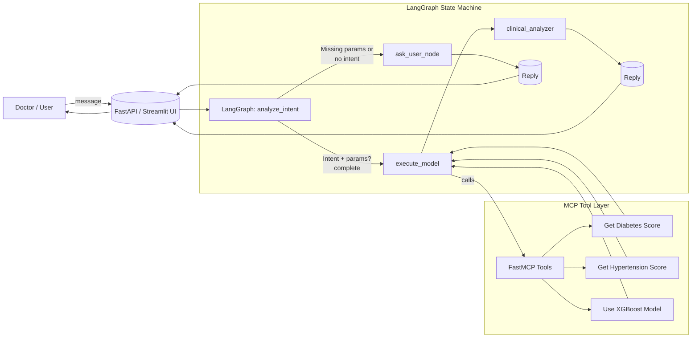
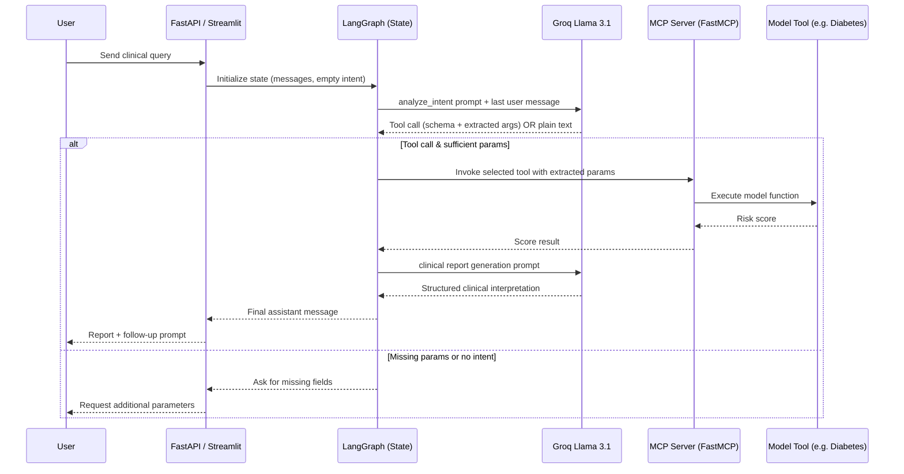

# Agent System

This directory contains a multi-agent system for medical assistance.

## Structure

- `main_system.py`: The main application logic with LangGraph.
- `server.py`: The MCP server.
- `mcp_client.py`: A client for the MCP server.
- `fast_client.py`: A client for a FastMCP server.
- `streamlit_app.py`: A Streamlit application for the agent system.
- `requirements.txt`: Project dependencies.

## Setup

1.  **Clone the Repository**
    ```bash
    git clone <your-repo-url>
    cd agent-system
    ```

2.  **Create a Virtual Environment** (Recommended)
    ```bash
    python -m venv venv
    source venv/bin/activate  # On Windows, use `venv\Scripts\activate`
    ```

3.  **Install Dependencies**
    ```bash
    pip install -r requirements.txt
    ```

4.  **Set Up Environment Variables**
    Create a file named `.env` in the root directory and add your Groq API key:
    ```
    GROQ_API_KEY="your-groq-api-key-here"
    ```

## How to Run

1.  Run the MCP server:
    ```bash
    python server.py
    ```
2.  In a separate terminal, run the main system:
    ```bash
    python main_system.py
    ```
    Or run the Streamlit app:
    ```bash
    streamlit run streamlit_app.py
    ```

## 🧠 Agent Orchestration Architecture

The system combines a LangGraph state machine, Groq LLM (tool-calling), and MCP-exposed model tools. The flow below shows how a user request is processed end‑to‑end.

### High-Level Flow



### Sequence (Detailed)



### Components

- LangGraph Nodes:
  - `analyze_intent`: Classifies intent & extracts structured params via tool schema binding.
  - `execute_model`: Calls FastMCP-decorated scoring tools.
  - `clinical_analyzer`: Generates clinician-style interpretation.
  - `ask_user_node`: Requests missing fields.
- MCP Tools (`models.py`): Lightweight mock implementations returning stochastic risk scores.
- Delivery Channels:
  - CLI (`main_system.py` loop)
  - REST (`/agent/chat` in `server.py`)
  - Chat UI (`streamlit_app.py`)
- External LLM: Groq `llama-3.1-8b-instant` used for both intent extraction & narrative report.

### State Data Contract (AgentState)

| Field | Purpose |
|-------|---------|
| `messages` | Full conversation history (LangChain messages) |
| `intent` | Resolved model intent (`predict_diabetes` / `predict_hypertension`) |
| `required_params` | Parameter names expected for the resolved tool |
| `extracted_data` | Parsed user-supplied structured values |
| `model_result` | Tool execution output (risk score + metadata) |

### Extension Ideas

- Add memory store for multi-turn gradual parameter collection.
- Introduce validation / normalization layer (ranges, units).
- Plug real predictive models or external EHR API instead of mocks.
- Add additional disease risk tools and auto tool selection heuristics.

---
Diagram generated automatically.
